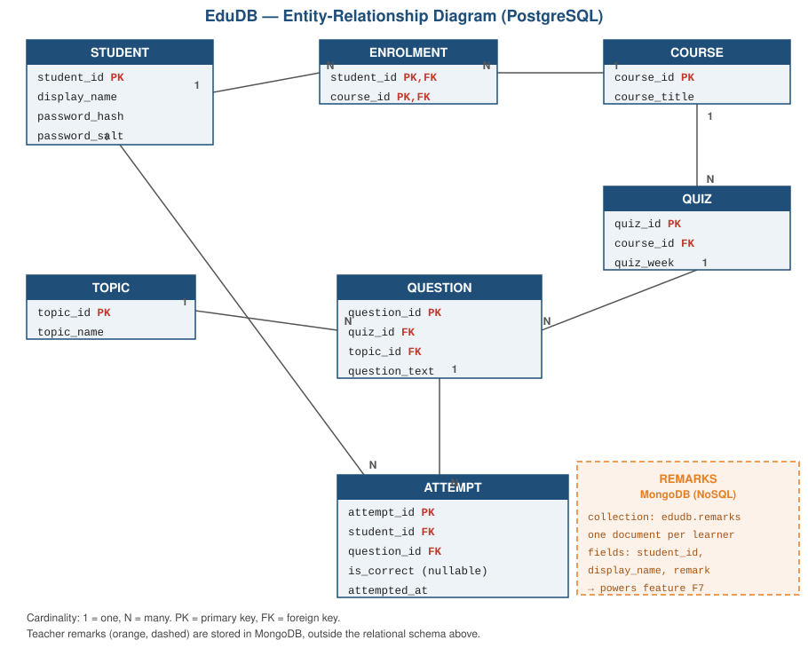

# EduDB

A minimal, server-side learning analytics demo for **INT4087 — Web Database
Applications for Data Analytics** (EdUHK). The whole application is one Flask file with nine
features (F1–F9). It uses PostgreSQL for the facts, MongoDB for the teacher
remarks, and DuckDB to read a columnar Parquet copy of the attempts. DuckDB is
an in-process analytical engine: feature F9 uses it to answer the same question
as the live dashboard, but from a file instead of the running database, which
shows the analytics (OLAP) half of the course. It uses no JavaScript, so every
number on the screen comes from one SQL query.

The goal is teaching: each function maps to one lesson, and the code is short
enough to print and read in class.

## Live demo (static preview)

A **live demo (static preview)** is published here:
<https://drhycheung.github.io/EduDB/>

That page shows fixed copies of the EduDB screens with synthetic data. It is a
rendered preview, **not the running application**: no database is connected and
the forms do not work there. The running application runs on your own computer
with Docker. Follow the steps below to start it. For the design rationale and how
the demo maps to the course, read [teaching-note.md](teaching-note.md).

## Features

| # | Screen | What it shows |
|---|--------|---------------|
| F1 | Dashboard | Correct-answer rate by question and by topic |
| F2 | Dashboard | (same screen) |
| F3 | Progress | Success rate per learner on each quiz — teacher sees all, learner sees only self |
| F4 | My attempts | A learner's own attempts; teacher sees everyone's |
| F5 | Sign in | Teacher / learner roles, one hash check |
| F6 | Search | Keyword and vector search over teaching notes |
| F7 | Remarks | Teacher adds one remark per learner (MongoDB); learner reads only their own |
| F8 | Chart | Bar chart drawn with plain HTML, no script |
| F9 | Parquet | The same rate read from a Parquet file with DuckDB |

## Database schema

The application stores its facts in seven relational tables in PostgreSQL. The
entity-relationship diagram below shows the tables and how they link.



`Attempt.is_correct` is nullable. A `NULL` means the learner skipped the question;
it is not counted as a wrong answer (see [teaching-note.md](teaching-note.md),
section 2.1).

Teacher remarks are **not** in this relational schema. They live in a separate
MongoDB collection, one document per learner, and power feature F7 and the L06
NoSQL lesson. See [teaching-note.md](teaching-note.md), section 2.2.

## Before you start

Install these once. (They are free.)

- **Python 3.9 or newer** — https://www.python.org/downloads/
  Check: `python3 --version` (macOS / Linux) or `python --version` (Windows)
- **Docker Desktop** — https://www.docker.com/products/docker-desktop/
  Check: `docker --version`
  After installing, **open Docker Desktop and wait until the whale icon in the
  menu bar stops moving** (the engine is ready). `docker compose up -d` fails
  with "Cannot connect to the Docker daemon" if Docker is not running.
- **Git** — https://git-scm.com/downloads
  Check: `git --version`

On macOS, AirPlay Receiver can hold port 5000. We use port **5055** instead,
on every platform, so the instructions below are identical for macOS and
Windows. You do not need to change anything for AirPlay.

## Run locally

### macOS and Linux

Open a terminal in an empty folder and run this whole block. The `#` notes are
comments — you can copy the block as it is; the shell ignores them. The nine
steps download the project, create an isolated Python environment, start the two
databases with Docker, load the sample data, and launch the web app.

```bash
git clone https://github.com/drhycheung/EduDB.git   # 1. download the project from GitHub
cd EduDB                                            # 2. enter the project folder
python3 -m venv .venv                               # 3. create an isolated Python environment
source .venv/bin/activate                           # 4. switch the terminal into that environment
pip install -r requirements.txt                     # 5. install the required Python packages
cp .env.example .env                                # 6. create your local settings file
docker compose up -d                                # 7. start PostgreSQL and MongoDB in containers
python seed.py                                     # 8. load the synthetic sample data into the databases
flask run --port 5055                              # 9. start the web application
```

Then open http://localhost:5055 in your browser.

### Windows

Open **Command Prompt** (or PowerShell) in an empty folder and run this whole
block. The nine steps are the same as the macOS block above (the `#` notes there
explain each one); only three commands differ, as noted at the end.

```cmd
git clone https://github.com/drhycheung/EduDB.git
cd EduDB
python -m venv .venv
.venv\Scripts\activate
pip install -r requirements.txt
copy .env.example .env
docker compose up -d
python seed.py
flask run --port 5055
```

Then open http://localhost:5055 in your browser.

(The only differences from the macOS block are `python` instead of `python3`,
`copy` instead of `cp`, and `.venv\Scripts\activate` instead of
`source .venv/bin/activate`.)

## Why port 5055?

Flask's default port is 5000. On macOS, the AirPlay Receiver service often
uses port 5000, which makes the local app fail to start. We use **5055** on
every platform so the steps are the same whether or not that conflict exists,
and whether you are on macOS or Windows.

## Stop the database

The application uses two containers started by `docker compose`: **PostgreSQL**
and **MongoDB**. Both are managed together.

When you are done, stop both containers:

```bash
docker compose down
```

This stops PostgreSQL and MongoDB, but keeps their data in Docker volumes for
next time. Closing Docker Desktop also stops both containers (and they restart
when you open Docker Desktop and run `docker compose up -d` again). To also
delete the stored data (a clean reset), add the volume flag:

```bash
docker compose down -v
```

## Sample accounts

The application has one teacher and six learners. The exact usernames and
passwords are shown on the **Sign in** screen of the running app (and on the
live preview's Sign in page), so you do not need to memorise them. Use the
teacher account to see the teacher views; use any learner account to see the
learner views.

## Project layout

```
EduDB/
  app.py            # the whole application (one file)
  schema.sql        # table definitions
  seed.py           # loads the synthetic data
  data/             # CSV data files and remarks.json (MongoDB seed)
  templates/        # Jinja2 HTML templates
  docker-compose.yml# starts PostgreSQL and MongoDB
  requirements.txt  # Python packages
  docs/             # static preview published with GitHub Pages
```

## Deployment note (SECRET_KEY)

For local teaching the default `SECRET_KEY` in `.env` is fine. Before you put
this on a shared server, set a strong, unique `SECRET_KEY` in `.env` (for
example, a long random string) so session cookies cannot be forged.

## Troubleshooting

- **`flask: command not found`** — your virtual environment is not active. Run
  `source .venv/bin/activate` (macOS / Linux) or `.venv\Scripts\activate`
  (Windows) first.
- **`ModuleNotFoundError`** — install the packages with
  `pip install -r requirements.txt` inside the active environment. Use the
  environment's own `python`/`pip`, not a system one.
- **Database errors on start** — make sure Docker is running and
  `docker compose up -d` finished without error.
- **Port already in use** — we use 5055; if something else holds it, stop that
  program or change `--port 5055` to another free port and open that instead.
